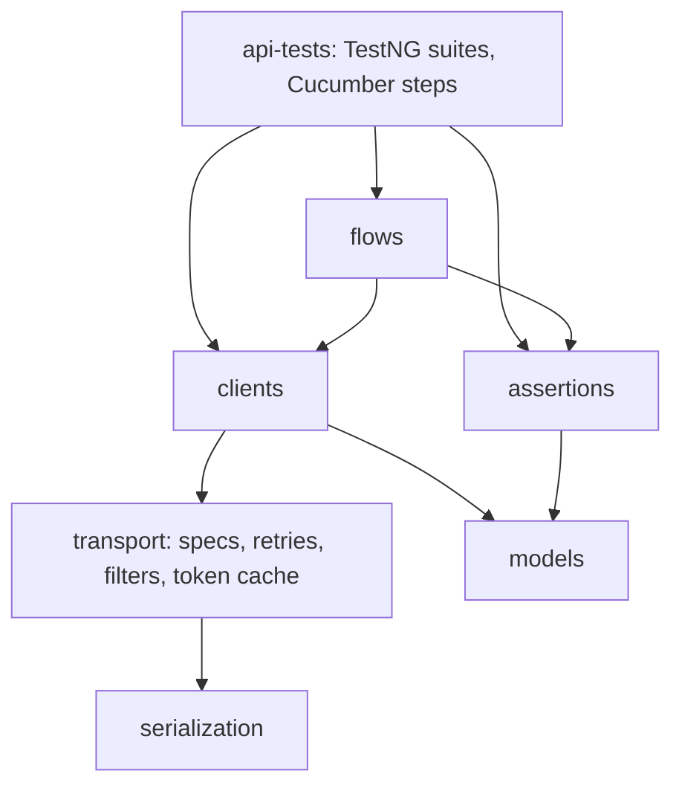

# restassured-api-framework

[](https://github.com/BhushanUpwanshi/restassured-api-framework/actions/workflows/ci.yml)

API test automation framework in Java 17, built against the public [restful-booker](https://restful-booker.herokuapp.com) API.

`api-core` is the framework, built as a Maven library with its own unit tests. `api-tests` depends on it the way a team's test repo depends on a framework pulled from Nexus. The same service layer drives TestNG suites and Cucumber scenarios.

**Stack:** Java 17 · Maven (multi-module) · REST Assured 5 · TestNG · Cucumber 7 · AssertJ · Jackson · WireMock · ArchUnit · Allure · JaCoCo · Spotless · Checkstyle · Docker · GitHub Actions · Jenkins

| | |
|---|---|
| Framework tests (`api-core`, WireMock, no network) | 129 |
| Live regression (`api-tests`, dev datasets) | 55 |
| Cucumber scenarios | 8 |
| Line coverage on `api-core` (build fails under 70%) | 86% |

## Two rules the build enforces

**1. The framework is a library.** `api-core` has no compile dependency on TestNG or Cucumber, and an ArchUnit rule fails the build if one appears. Its own tests run against WireMock, so they never go red because a shared host is slow. They also cover what a real API won't do on request: a 503 followed by a 200, a read timeout, a malformed body.

**2. Layers only depend inward.**



`flows` never touch `transport`. Tests never build a request spec or handle a token. `models` depend on nothing in the framework. ArchUnit checks all of this on both sides (`LayeringRulesTest` in `api-core`, `TestLayeringRulesTest` in `api-tests`). I planted a violation to watch each rule fail before trusting it.

## Layout

```
api-core/                      the framework
  config/                      layered config: -D property > env var > config-<env>.properties > defaults
  transport/                   Specs, Retries, RetryPolicy, CorrelationIdFilter, HttpLogFilter, AuthTokenCache, ApiResponse
  clients/                     ApiClient, AuthenticatedClient, AuthClient, BookingClient
  flows/                       BookingFlow: create-and-verify, change price, replace, cancel
  assertions/                  ApiResponseAssert, BookingAssert (custom AssertJ)
  data/                        BookingFactory (Datafaker), CreatedResourceRegistry (per-thread cleanup)
  models/                      request, response and error records
  ApiFramework.java            wires the layers, the only place that builds transport objects
api-tests/
  auth/ booking/               TestNG suites: CRUD, validation, schema, search, response time
  bdd/                         Cucumber runner, steps, hooks
  data/                        dataset loader and the records cases bind to
  resources/testdata/<env>/    the test matrix, as JSON
  resources/features/          Gherkin
  resources/schemas/           JSON schemas for every response shape
```

## Running it

Needs JDK 17 (`JAVA_HOME` set). The Maven wrapper brings its own Maven.

```bash
export API_USERNAME=admin API_PASSWORD=password123   # restful-booker's public demo login

./mvnw verify -pl api-core                        # framework tests, layer rules, coverage, static checks (offline)
./mvnw install -DskipTests                        # make api-core available to api-tests
./mvnw test -pl api-tests -Dsuite=smoke
./mvnw test -pl api-tests                         # regression, in parallel
./mvnw test -pl api-tests -Pqa                    # same code, qa datasets
./mvnw test -pl api-tests -Dsuite=bdd             # Cucumber

docker compose run --rm tests                     # the hermetic suite with no JDK installed
```

On Windows PowerShell, set the credentials with `$env:API_USERNAME = "admin"` and use `.\mvnw.cmd`. Credentials only come from environment variables. There is no default value and no properties file for them, so a missing one fails straight away with a message naming the variable.

Reports: `api-tests/target/allure-results` (`allure serve` it), `api-tests/target/cucumber-report.html`, `api-core/target/site/jacoco/index.html`.

## Data-driven test matrix

Test cases come from JSON, not from Java. To add a validation case, add an object to `testdata/default/booking-validation.json`. The test count goes up by one and no Java file changes.

```json
{
  "id": "BV-12",
  "description": "KNOWN DEFECT: accepts a negative totalprice",
  "tags": ["known-defect", "boundary"],
  "request": { "firstname": "Asha", "lastname": "Rao", "totalprice": -5, "depositpaid": true,
               "bookingdates": { "checkin": "2026-12-01", "checkout": "2026-12-05" } },
  "expect": { "status": 200, "fields": { "booking.totalprice": -5 } }
}
```

- `testdata/qa/booking-crud.json` **replaces** the default file for `-Pqa`. It isn't merged, because with a deep merge nobody can say which dataset actually ran.
- A case can be limited to some environments or disabled. Skipped cases are counted in the log (`booking-validation: 18 cases, 18 run, 0 skipped for env=dev`), never dropped without a trace.
- Reports name the case (`BV-12 KNOWN DEFECT: accepts a negative totalprice`), not `[11]`.
- `DatasetContractTest` validates every dataset file: unique ids, descriptions present, schema files exist, known defects labelled as such.

Sequence-dependent behaviour stays in Java: the create → update → cancel lifecycle, token refresh, parallel logins. Encoding control flow in JSON makes a script nobody can read.

## What the live API actually does

Every expected value was taken from a live response, not guessed. Several differ from what a textbook REST API would return, and the framework is built around what really comes back:

| Call | Response |
|---|---|
| `POST /auth` with a wrong password | **200** with `{"reason":"Bad credentials"}` |
| Auth on writes | `Cookie: token=...`. `Authorization: Bearer` gets a 403 |
| `POST /booking` | **200**, body wraps `{bookingid, booking}` |
| `POST` with a required field missing or null | **500** `Internal Server Error` |
| `POST` with malformed JSON | 400 |
| `PUT` with a required field missing | **400**, while the same mistake on `POST` gives 500 |
| `DELETE` | **201** `Created`. A second delete gets 405 |
| `PATCH` on an absent id | 405 |
| Any `Accept` other than exactly `application/json` | **418 I'm a Teapot** |

The 418 was found on the first live run. REST Assured's `ContentType.JSON` sends four media types in `Accept`, and every one of the WireMock tests passed because a stub doesn't check that header. There is now a stub test that pins the exact header.

Seven cases in the validation set are tagged `known-defect`: the API accepts a negative price, a text price (stored as `null`), a decimal price (truncated), checkout before checkin, an unparseable date (stored as `0NaN-aN-aN`), `"depositpaid": "yes"`, and an empty first name. The tests pin the current behaviour, so a server-side fix breaks a named test instead of passing unnoticed.

## Design decisions

**Transport retry and test retry are different things.** `Retries` re-sends a request on connection reset, 502/503/504 or read timeout, with exponential backoff and a cap. `RetryAnalyzer` re-runs a test, which can hide product bugs, so it only applies to the two timing tests in the `third-party-timing` group. Retry can't be a REST Assured filter: the filter chain is single-use, and calling `next()` twice returns null.

**A typed `ApiResponse<T>` instead of raw `Response`.** It holds the bound body, status, headers, duration and raw body. Tests assert on objects, a response-time check is an ordinary assertion, and no test touches an `ObjectMapper`. Error bodies (plain text on this API) aren't bound, so a 404 reaches the test as a 404, not as a deserialization exception.

**One mapper for both directions.** Without wiring the configured Jackson mapper into REST Assured, outbound bodies used REST Assured's default instance, and a `LocalDate` went out as `[2026,11,1]`.

**Per-thread token and cleanup.** `AuthTokenCache` keeps one token per thread, logs in lazily, and refreshes once on a 401/403 (exactly once, no login loop). `CreatedResourceRegistry` records every booking a thread creates and deletes them newest first after each test. A cleanup failure is logged and never replaces the test's own result. Suites run with `parallel="methods"`, and a run leaves no bookings behind.

**Flows verify as they go.** `BookingFlow.updatePriceAndVerify` checks that the price changed and that nothing else did, which catches a PATCH that behaves like a PUT. `cancelAndVerifyGone` checks the read after the delete, because a 201 on delete proves very little.

**Schemas catch what models ignore.** The models skip unknown fields on purpose, so a server-side addition can't break the whole suite. The JSON schemas set `additionalProperties: false`, so drift fails `SchemaTests` and nowhere else.

**Cucumber for behaviour, JSON for the matrix.** Feature files keep small `Examples` tables a product owner can read. The 18-row validation matrix stays in JSON and gets a single scenario that runs every row and reports every failure, not just the first one.

**Gates in the build.** `mvn verify` fails on a coverage drop below 70%, a Checkstyle violation, or a Spotless formatting issue. I broke each one on purpose to see it fail. Spotless covers import order, whitespace and newlines but doesn't reformat whole files, because the code is wrapped by hand for reading.

## CI

GitHub Actions (`.github/workflows/ci.yml`) runs on every push, every pull request and once a day:

1. `api-core`: unit tests, ArchUnit, JaCoCo floor, Spotless and Checkstyle, all offline
2. `api-tests`: smoke, regression, regression on the qa datasets, then BDD, all against the live API

Only step 2 can fail because of the network. Set `API_USERNAME` and `API_PASSWORD` as repository secrets.

The `Jenkinsfile` runs the same stages, with an environment parameter, JUnit and coverage publishing and an Allure report. It reads the login from a Jenkins credential with the id `restful-booker`.
